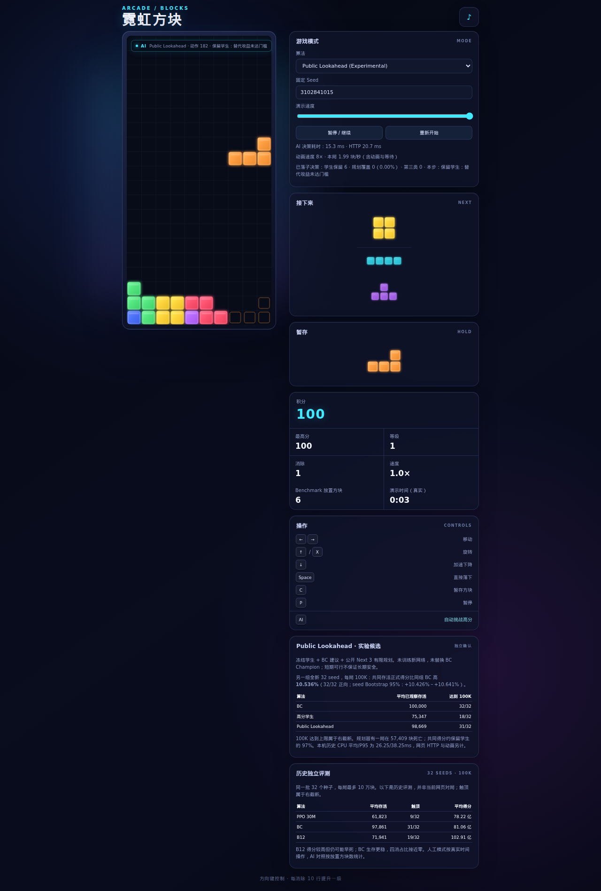

# Public Lookahead AI 网页集成与正式展示

完成时间：2026-10-30T15:20:34+08:00（Asia/Shanghai）。来源 `codex/model-based-planning@a3bfc02`；集成分支 `codex/public-lookahead-web`，应用实现提交 `bb33ff7`，最终报告、脚本及原始证据按本分支后续提交归档。

## 访问与交付状态

- **网页：[http://100.91.227.47:8080/](http://100.91.227.47:8080/)**，需连接同一 Tailscale 网络。
- **推理健康：[http://100.91.227.47:8081/api/health](http://100.91.227.47:8081/api/health)**。
- 下拉选择 **Public Lookahead (Experimental)**；默认仍为 V2 Hold-only。Human、V1、V2 Hold-only、V2 Beam-8、PPO 30M、BC Champion、Hybrid B12 都保留。
- 正式8080/8081健康；验证任务正常结束，临时8082/8083服务已退出。当前持久服务tmux：`tetris-lookahead-web`、`tetris-lookahead-inference`。
- 无新训练、无调参、无新独立质量确认、无冠军替换、无main合并和版本发布。

## 冻结身份与公开信息边界

本轮集成的是混合控制器，没有新的单神经网络。服务加载冻结学生与BC调用原 `PublicLookaheadController`，PPO留供旧模式使用。

|对象|SHA256|
|---|---|
|高分学生 epoch1|`e40bfad269566c052d880cb01857f5bd998e22a1730c6a71d75845387f605914`|
|BC Champion|`5f5613cb5eb4e80a02406b70902ad3d5c571eb8fe38bec4b40f73b34289ca663`|
|PPO 30M|`eb859b8989efe8f3332393ed57110036979b03bb4d3d8d8316d080cf04b2da34`|
|规划器源码|`0c2dbea26708fed866c5089eb102672b0cfccafeaa9f130b58086c847e8ffb08`|

启动时验证模型及规划源码身份。配置仍为 `{'depth': 4, 'roots': 4, 'override_margin': 12.0}`；本轮未改变搜索代价、权重、深度、候选规则或覆盖门槛。Python Core、JS合法落点及传统规则源文件与a3bfc02逐文件Git比较一致。game.js只改模式接线、统计和展示；正式计分/落子仍经过原执行器及Parity验证。

HTTP只接受公开棋盘、Current、Hold/可用性、Next3、公开分数/行数/等级等公开观察字段，以及浏览器正式合法Action ID列表。隐藏字段被拒绝，Next必须恰好3项，浏览器mask列表必须与Python正式合法列表一致。规划器只构建公开模拟状态，未知未来处按原规则停止，不读取真实Core/RNG/Bag。

`/api/health`输出模型身份、模式和冻结配置；响应额外提供学生/BC首选、是否覆盖、是否第三类、简短理由及计算/排队耗时。服务不保存浏览器游戏状态或跨浏览器采用计数。

## 网页信息与统计语义

正式得分、消行、放置方块数沿用现有统计。新增：服务器决策毫秒、HTTP毫秒，学生动作保留次数、覆盖次数/比例、第三类动作次数和当前决策理由。

计数仅在真实HardDrop落子成功后增加，不在请求返回时增加；暂停、取消、刷新重发不会重复计入尚未执行的决策。第三类是覆盖的子集（动作同时不同于学生和BC首选），比例分母为保留+覆盖。重新开始清零，刷新保存已落子计数，模式切换会隔离旧请求。

演示倍率只控制输入路径动画；“块/秒”含动画与等待，不是纯推理吞吐。10K加速验证禁用自动动画时钟、人工推进原浏览器BFS输入路径，因此该验证截图里的演示时间不能用作播放测速；下图来自另行原生动画检查。

网页将新确认结果放在独立区块：另一组32seed、100K上限，共同窗口正式得分相对同组BC +10.536%，32/32正向，seed Bootstrap95%区间+10.426%～+10.641%；规划31/32、BC32/32达到上限，规划一局57409块死亡。**达到100K是右截断，仍是实验候选；这些历史数据不是当前网页对局，也不与原历史32组混算。**



## 真实 HTTP + Chromium + 网页执行器验证

使用 Chromium 156.0.8078.4，从实际8080页面加载JS，通过实际8081 HTTP返回动作，再执行网页的原始BFS路径。未绕过游戏执行器调用测试用落子函数。

|阶段|Seed|实测块数|正式Core逐步检查|冻结规划器离线动作比较|结果|
|---|---:|---:|---:|---:|---|
|隔离8082/8083预检|3102841000|300|300|300|通过|
|正式8080/8081预检|3102841000|300|300|300|通过|
|正式稳定性|3102841001|10000|10000|首阶段已验证300步|达到上限、无死亡、无脚本错误|

每步比较动作合法集合、动作ID、棋盘、Current、Hold/可用性、Next3、正式得分、行数、等级、结束/phase及块数。300步还直接加载冻结学生/BC调用未修改规划器，核对HTTP动作及两教师首选和覆盖标志。

10K最终正式得分 **92,344,800**、消行 **3,997**；学生保留 **9933**、覆盖 **67（0.67%）**、第三类 **23**。达到10K为右截断。这是工程稳定性样本，不是新的生存/得分优势确认，也没有使用历史正式确认组调参。

### 交互、故障和并发

- 真页面按钮完成暂停/恢复，刷新恢复模式和已落子计数。
- 延迟一份真实HTTP响应后切换Human，旧响应不能落子或累计规划计数。
- 将一份真实HTTP响应注入503后，页面停止自动请求、显示重试，重试成功。
- 保留真实10秒超时：实测约 **10049ms** 触发“请求超时”，随后重试成功。
- 原V1、V2、PPO、BC、B12均在真实页面至少执行一次合法落子，配合既有JS和Python回归。
- **两个独立Chromium进程**同时各运行64块，同Seed动作序列一致、各自计数64，不发生服务端游戏状态或统计串用。
- 公开接口拒绝隐藏Bag、Next4、错误/缺失mask（400），拒绝不允许来源（健康请求403），合法预检204。另8个同时HTTP请求得到 `[200, 503, 503, 200, 503, 200, 503, 200]`，4个200/4个503；接收的动作一致，健康仍200。服务最多4个在途推理请求、模型访问串行，超出容量不无限排队。

## 性能

单位ms，格式为**平均 / P95 / P99**。服务器决策含排队、公开特征和规划，不含HTTP解析/传输；HTTP从浏览器fetch到响应读取，含网络/CORS/客户端解析。下列正常性能不含刻意故障注入或8请求饱和探测。

|条件|服务器决策|HTTP|队列等待|
|---|---|---|---|
|正式300步|16.78 / 23.25 / 28.24|20.12 / 26.50 / 31.10|0.00 / 0.00 / 0.00|
|单浏览器10K|17.59 / 24.08 / 29.62|23.92 / 30.90 / 36.40|0.00 / 0.00 / 0.00|
|双浏览器128步|20.16 / 29.34 / 42.51|29.41 / 43.70 / 55.40|2.19 / 10.00 / 16.15|

10K服务器纯计算为 **17.59 / 24.07 / 29.62ms**；浏览器逐块输入路径同步执行耗时为 **1.97 / 2.50 / 2.80ms**，这是加速执行时间，不是动画播放时长。

该运行墙钟 345.25s，包含逐步Core校验和断点开销。API进程CPU时间/墙钟为 **53.75%（以一个逻辑CPU的100%计）**，结束RSS约 **707.58MiB**；线程Torch/BLAS设为1，模型device=CPU。机器AMD Ryzen7 6800H，Python 3.12.3、PyTorch 2.10.0+cu130、NumPy 2.5.3。与历史100K研究相比局面分布、时间测量链路不同，不把本10K分位数当作新的长期推理基准。

原生动画另测同Seed、每档约3秒：0.25×放置0块，8×放置6块；首动作均为21。该短展示用于核对倍率与推理分离，不用于游戏质量比较。

## 回归与已定位的工程中断

- Python/Parity **33 tests +35 subtests passed**；JS **70 tests passed**。完整输出及SHA在证据文件和runs日志中。
- 验证队列曾在10K完成后因运行中的shell文件被编辑导致EOF；保存原日志，修正静态脚本后仅恢复未完成任务。
- 交互测试首次在刷新等待处超时：加速测试禁用RAF，却使用Playwright默认RAF谓词轮询。改成10ms真实定时轮询后全部交互检查通过；未改生产页面或规划算法。
- 已完成300/10K结果的SHA在恢复前后完全相同；重复启动完成任务会复用结果，不以短重跑覆盖原性能数据。失败日志永久保留在`runs/model_based_planning_web/failures/`及原queue日志。

## 部署、恢复及运行方式

当前工作目录：`/home/wyh/projects/tetris-ai-benchmark-lookahead-web`。8080由 `tetris-lookahead-web`、8081由 `tetris-lookahead-inference` 的tmux会话持久运行；断开SSH不影响。日志为`runs/model_based_planning_web/production-web.log`和`production-api.log`。

先在8082/8083验证，再由`ops/replace_web_service.py`预加载并校验模型后替换旧进程；API/static重绑定间隔分别约 **52.52/27.43ms**，不是零停顿切换。旧命令、cwd及PID记录于`deployment/*-handoff.json`，绑定失败会自动按旧命令恢复。本次没有触发回滚。

日后正常重启可从集成目录按根README/网页README使用 `python3 -m http.server` 与 `.venv/bin/python -m training.web_inference` 启动8080/8081；先检查现有tmux和端口，勿重复启动。保持配置`--host 100.91.227.47 --port 8081 --web-origin http://100.91.227.47:8080`及单线程环境变量。原稳定源码与模型仍在原工作区；需要回退时停止这两个新会话，按handoff记录的旧cwd/command重新启动。

复现浏览器测试的Playwright安装与命令见[网页说明](../../tetris-game/README.md)。完整串行队列：

```bash
bash ops/run_lookahead_web_validation.sh 100.91.227.47
.venv/bin/python -m tests.integration.lookahead_http --output runs/model_based_planning_web/http-boundary.json
```

队列有互斥锁、有限超时和原子Core/浏览器断点；已完成结果幂等复用，工程种子仅用于回归。验证使用Playwright 1.64.1（网页README按该版本安装）；安装包锁保留于`runs/model_based_planning_web/browser-runtime/package-lock.json`。

原始公开轨迹、浏览器存档、真实Core断点、逐chunk SHA、性能结果、故障与部署记录保留于 `runs/model_based_planning_web/`；[机器可读证据](model_based_planning_web_integration.json)汇总身份、指标和测试结果。生产服务保持运行，临时服务与测试浏览器已结束。
